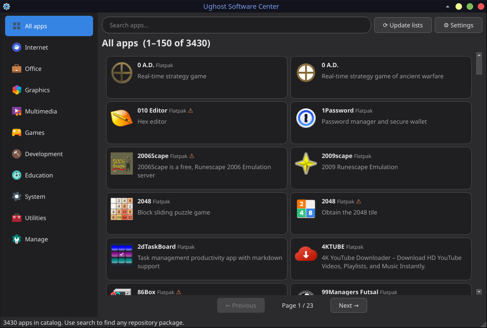
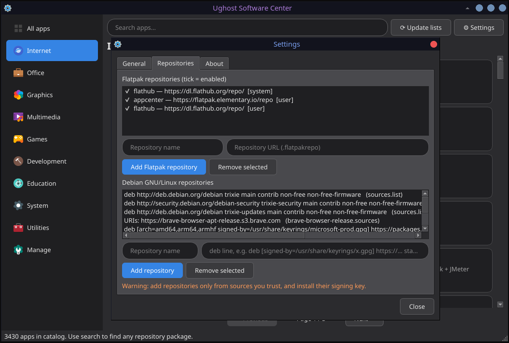
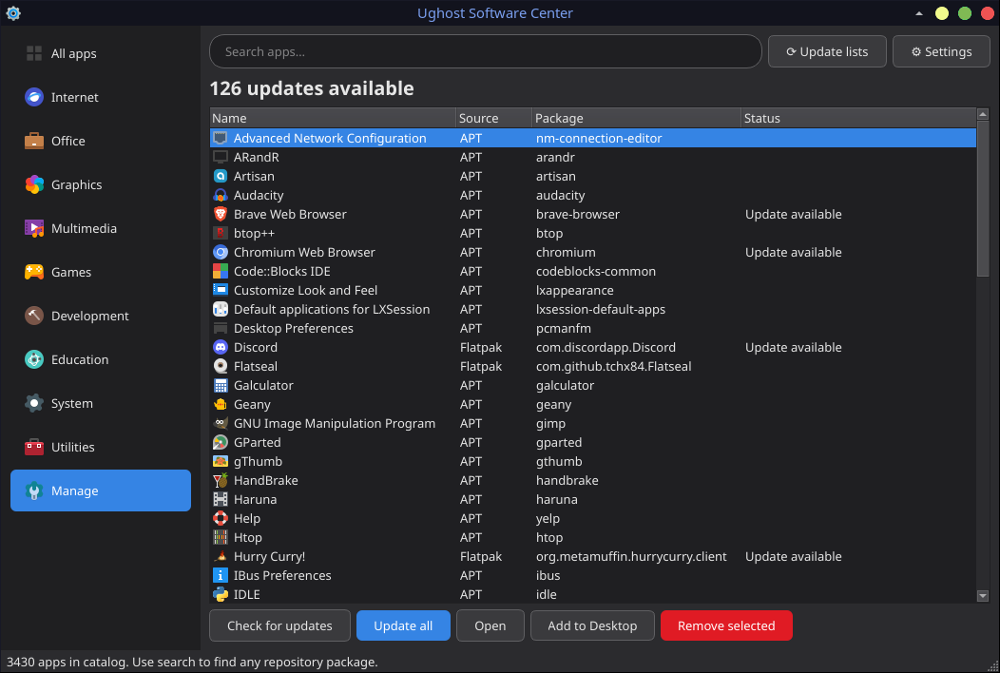

# Ughost Software Center


-green)



A lightweight Software Center for Window Manager (WM) users on GNU/Linux, written in Python with Qt6 (PySide6).

Manage all your apps from your distribution's default repository and Flatpak, using a simple GUI. No terminal needed.

## Features


- **One place for everything**: browse, install and remove apps from your system repository and Flatpak.
- **Multi-distro**: works with APT (Debian/Ubuntu), DNF (Fedora), pacman (Arch) and zypper (openSUSE).
- **Search and categories**: Internet, Office, Graphics, Multimedia, Games, Development, Education, System and Utilities.
- **Manage tab**: check for updates, update everything at once, or remove selected apps.
- **Flatpak repositories**: enable, disable or add remotes (`.flatpakrepo`) from Settings.
- **Safety hint**: apps from unverified Flatpak developers are clearly marked, and can be hidden.
- **Themes**: follows your system light/dark theme automatically.
- **Languages**: English and Bahasa Indonesia.
- **Light on resources**: a single Python script, no heavy desktop environment required.

## Installation

Download the package for your distribution from the [Releases](../../releases) page.

**Debian / Ubuntu / Mint (amd64)**

```bash
sudo apt install ./ughost-software-center_0.0.1~beta-1_amd64.deb
```

**Fedora / openSUSE (x86_64)**

```bash
sudo dnf install ./ughost-software-center-0.0.1-0.1.beta.x86_64.rpm
```

### Dependencies

- Python 3
- PySide6 (Qt6 bindings for Python)
- Flatpak (optional, only needed for Flatpak apps)

### Run from source

```bash
pip install PySide6
python3 ughost-software-center
```

## Usage

Launch it from your application menu, or from a terminal:

```bash
ughost-software-center
```
## Unistall Apps & Manage to desktop using GUI Mode


### What features in this apps?
- Uninstall Apps by default repository or flatpak
- Create/remove Shortcut apps & Custom apps to Desktop
- GUI mode

Show version and credits:

```bash
ughost-software-center --info
```

```
* Developer : OOGR (Opensource OS Gathering Republic)
* Version : 0.0.1-Beta
* Maintener : Didi Sloth Stanca
```

## Building the packages

`build.py` creates both the `.deb` (amd64) and the `.rpm` (x86_64) into `dist/`. A `ughost-software-center.spec` file is also included if you prefer to build the RPM with `rpmbuild -ba`.

```bash
python3 build.py
```

## Status

This is a **Beta** release (0.0.1). Expect rough edges, and please report bugs by opening an issue.

## Credits

- **Developer**: OOGR (Opensource OS Gathering Republic)
- **Maintainer**: Didi Sloth Stanca

## License

Ughost Software Center is free software, licensed under the **GNU General Public License v3.0**.
You can redistribute it and/or modify it under the terms of the GPL as published by the Free Software Foundation, version 3 of the License.

This program is distributed in the hope that it will be useful, but WITHOUT ANY WARRANTY; without even the implied warranty of MERCHANTABILITY or FITNESS FOR A PARTICULAR PURPOSE. See the [LICENSE](LICENSE) file for the full text.
